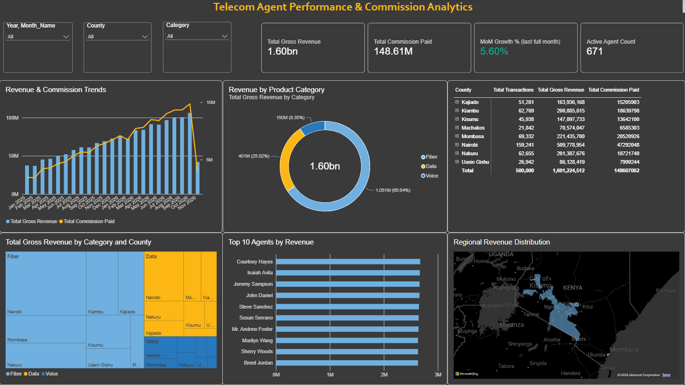

# 📡 Telecom Agent Performance & Commission Analytics

An end-to-end analytics project that tracks **agent sales performance, revenue and commission payouts** for a telecom company selling Fiber, Data and Voice products through a network of field agents across Kenya. A Python script generates a realistic star-schema dataset, and a **Power BI dashboard** turns it into insights on revenue trends, product mix, county performance and top agents.



---

## 📌 Table of Contents
- [Project Overview](#-project-overview)
- [Business Questions](#-business-questions)
- [Data Model](#-data-model)
- [Synthetic Data Generation](#-synthetic-data-generation)
- [Dashboard Features](#-dashboard-features)
- [Key Metrics](#-key-metrics)
- [Key Insights](#-key-insights)
- [Recommendations](#-recommendations)
- [Tech Stack](#-tech-stack)
- [Repository Structure](#-repository-structure)
- [Getting Started](#-getting-started)
- [Future Improvements](#-future-improvements)
- [Author](#-author)

---

## 🔍 Project Overview

Telecom companies depend on agents to sell products and earn commission on every sale. Leadership needs a clear view of what those agents generate and what it costs to reward them.

This project simulates **500,000 sales transactions** made by **800 agents** (671 of them active) across **8 Kenyan counties** between **1 January 2025 and 12 November 2026**. The results are presented in an interactive dashboard with KPI cards, trend analysis, geographic breakdowns and an agent leaderboard. All monetary values are in **Kenyan Shillings (KES)**.

## 🎯 Business Questions

1. How are gross revenue and commission paid trending over time?
2. Which product categories contribute most to revenue?
3. Which counties perform best, and which are lagging?
4. Who are the top-performing agents, and is revenue concentrated in a few of them?
5. Is commission spend proportionate to the revenue generated?

## 🗄️ Data Model

The data follows a **star schema** with one fact table and three dimension tables.

| Table | Type | Description |
|---|---|---|
| `Fact_Sales` | Fact | One row per transaction: `Transaction_ID`, `Date`, `Agent_ID`, `Product_ID`, `Amount_KES`, `Commission_KES` |
| `Dim_Agent` | Dimension | `Agent_ID`, `Agent_Name`, `County`, `Agent_Status` (Active / Inactive) |
| `Dim_Product` | Dimension | `Product_ID`, `Product_Name`, `Category`, `Base_Price_KES`, `Commission_Rate` |
| `Dim_Date` | Dimension | `Date`, `Year`, `Quarter`, `Month_Num`, `Month_Name`, `Day_of_Week` |

**Relationships:** `Fact_Sales[Agent_ID]` → `Dim_Agent`, `Fact_Sales[Product_ID]` → `Dim_Product`, `Fact_Sales[Date]` → `Dim_Date`.

**Product catalogue**

| Product | Category | Base Price (KES) | Commission Rate |
|---|---|---|---|
| 10GB Monthly Data | Data | 1,000 | 5% |
| 50GB Monthly Data | Data | 3,000 | 5% |
| Home Fiber 20Mbps | Fiber | 4,000 | 10% |
| Home Fiber 50Mbps | Fiber | 6,500 | 12% |
| Unlimited Voice Plan | Voice | 1,500 | 7% |

## ⚙️ Synthetic Data Generation

`telecom_data.py` builds the dataset with **pandas, NumPy and Faker**, seeded with `42` so results are reproducible. Key design choices:

- **Agents:** 800 agents with unique Faker-generated names (`fake.unique.name()`), assigned to counties with weighted probabilities (Nairobi 30%, Mombasa 15%, Kiambu 15%, Nakuru 10%, Kisumu 10%, Kajiado 10%, Machakos 5%, Uasin Gishu 5%). About 85% are `Active`.
- **Only active agents make sales**, which keeps the data logically consistent.
- **Business growth is simulated** by weighting transaction dates so later dates are more likely, producing the upward trend in the dashboard.
- **Price variance:** each sale amount is the base price multiplied by a random factor between 0.85 and 1.15 to mimic discounts and up-sells.
- **Commission** is calculated as `Amount_KES × Commission_Rate` for the product sold.
- The script exports four CSV files: `Dim_Product.csv`, `Dim_Agent.csv`, `Dim_Date.csv` and `Fact_Sales.csv`.

## 🖥️ Dashboard Features

**Slicers:** Year / Month, County, Product Category

| Visual | Purpose |
|---|---|
| **KPI Cards** | Total Gross Revenue, Total Commission Paid, MoM Growth (last full month), Active Agent Count |
| **Revenue & Commission Trends** | Gross revenue (columns) against commission paid (line) for each month from Jan 2025 to Nov 2026 |
| **Revenue by Product Category** | Donut chart showing the share of Fiber, Data and Voice |
| **County Summary Table** | Transactions, gross revenue and commission paid per county |
| **Revenue by Category and County** | Treemap showing each county's contribution within each product line |
| **Top 10 Agents by Revenue** | Bar chart ranking the highest-earning agents |
| **Regional Revenue Distribution** | Map of revenue across Kenya |

**Measure notes**
- **MoM Growth (last full month)** compares the most recent *complete* month with the month before it (October vs September 2026), so a partial month at the end of the data does not distort the result.
- **Active Agent Count** counts agents with the `Active` status in `Dim_Agent`.

## 📊 Key Metrics

All data, 1 January 2025 to 12 November 2026:

| KPI | Value |
|---|---|
| Total Gross Revenue | **KES 1.60bn** |
| Total Commission Paid | **KES 148.6M** |
| Total Transactions | **500,000** |
| Active Agents | **671** (of 800) |
| Commission-to-Revenue Ratio | **~9.3%** |
| MoM Growth (October vs September 2026) | **+5.6%** |

By year: **2025** generated KES 656.3M from 205,423 transactions, and **2026** (to 12 November) generated KES 944.9M from 294,577 transactions, already about 44% above the full previous year.

## 💡 Key Insights

- **Fiber is the revenue engine.** Fiber contributes **KES 1,051M (65.6%)** of revenue, Data **401M (25.0%)** and Voice **150M (9.3%)**. Sales volume is spread evenly across products, so Fiber's lead comes from its higher price points.
- **Nairobi dominates.** It generated **KES 509.8M**, about **32%** of total revenue, from 159,241 transactions. Mombasa (221.4M), Nakuru (201.4M) and Kiambu (200.9M) form the next tier.
- **Smaller markets trail.** Machakos (70.6M) and Uasin Gishu (86.1M) contribute the least.
- **County revenue tracks agent count.** Nairobi has 214 active agents, while Machakos has 29 and Uasin Gishu 36. Revenue per agent is similar across counties (roughly KES 2.4M each), so a county's revenue is driven mainly by how many agents it has. This reflects how the data is simulated, and real data would likely show more variation.
- **Revenue is spread evenly across agents.** The top 10 agents each earned between about KES 2.63M and 2.67M, against a median of about 2.39M across all active agents, so no single agent dominates.
- **Steady growth over time.** Monthly revenue rose from about KES 37M in January 2025 to about KES 106M in October 2026, nearly tripling, with commission rising in step. The sharp drop at the end of the trend chart is November 2026, a partial month (data ends on 12 November), not a real decline.
- **Commission cost is stable** at about 9.3% of revenue, driven by the product mix and commission rates.

## ✅ Recommendations

1. **Protect and grow Fiber sales.** It drives two-thirds of revenue and carries the highest commission rates, so monitor payout efficiency as volumes scale.
2. **Cross-sell Data and Voice** to Fiber customers to lift the smaller categories.
3. **Recruit agents in underperforming counties.** Since revenue follows agent count, Machakos and Uasin Gishu have the most room to grow through recruitment and training.
4. **Look beyond volume.** With evenly spread performance, tiered or target-based commission could help reward and develop higher performers.
5. **Review commission structure regularly** to keep payout in proportion to revenue as the business grows.

## 🛠️ Tech Stack

- **Python** (pandas, NumPy, Faker): data generation
- **Power BI**: data modelling, DAX measures and dashboard design
- **Bing Maps visual**: regional revenue distribution
- **Git & GitHub**: version control

## 📁 Repository Structure

```
telecom-commission-analytics/
│
├── README.md                # Project documentation
├── telecom_data.py          # Script that generates the dataset
├── telecom_dashboard.png    # Dashboard screenshot
├── Dim_Agent.csv            # Generated data
├── Dim_Date.csv
├── Dim_Product.csv
├── Fact_Sales.csv
├── telecom-agent-performance-bi.pbix   # Power BI report
└── .gitignore
```

## 🚀 Getting Started

### Prerequisites
- Python 3.8+
- Power BI Desktop (Windows)

### Steps

1. **Clone the repository**
   ```bash
   git clone https://github.com/HildaKiptoo/telecom-commission-analytics.git
   cd telecom-commission-analytics
   ```

2. **(Optional) Regenerate the dataset.** The CSVs are already included, but you can recreate them:
   ```bash
   pip install pandas numpy faker
   python telecom_data.py
   ```

3. **Open `telecom-agent-performance-bi.pbix`** in Power BI Desktop.

4. **Update the data source path.** Power BI stores the full file path of each CSV, so after cloning go to **Home → Transform data → Data source settings → Change Source** and point each of the four CSVs to your local folder, then click **Refresh**.

## 👩‍💻 Author

**Hilda Kiptoo**
GitHub: [@HildaKiptoo](https://github.com/HildaKiptoo)

---

⭐ If you found this project useful, please consider giving it a star!
